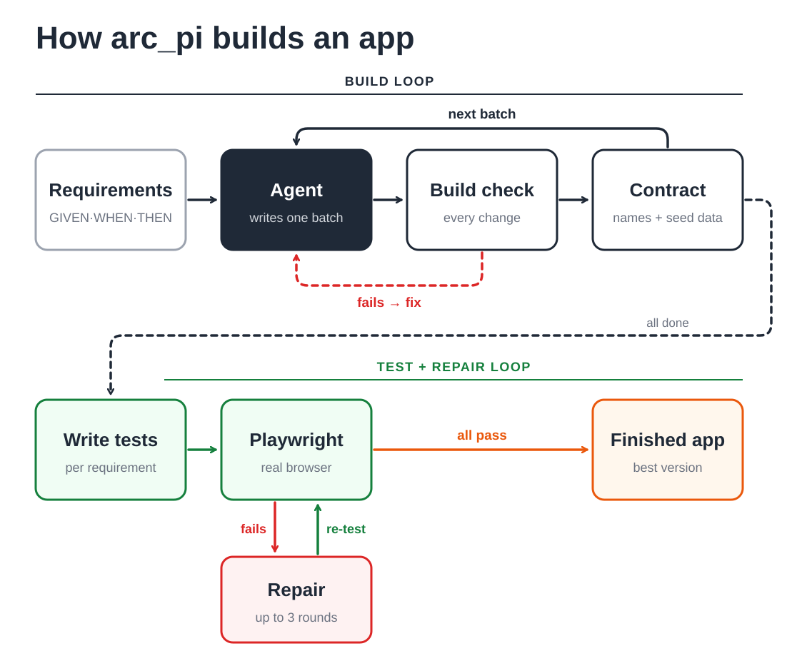

<div align="center">

# arc_pi_r6

[English](README.md) · **简体中文**

## Limitless 团队 · 2026 OAIC Agentic Software Factory 黑客松决赛项目

### 输入需求树，输出全栈 Web 应用。

**用 GIVEN/WHEN/THEN 场景写下应用要做什么。编码智能体负责实现，在真实浏览器中测试，并自动修复。**

[](LICENSE)


[快速开始](#快速开始) · [工作原理](#工作原理) · [编写需求](#编写需求) ·
[参考](#参考) · [已知限制](#已知限制) · [许可证](#许可证)

</div>

---

`arc_pi` 是一个 Python 编排框架（harness）。你提供一棵需求树：一个包含 GIVEN/WHEN/THEN 场景的 YAML
需求文件。它驱动编码智能体，直到 React + Vite 前端和 Express 后端实现整棵需求树。

- **Python 负责整个循环：** 排序、分批、时限、构建、Playwright 验证、修复、快照、证据记录。
- **引擎是 [Pi agent](https://github.com/earendil-works)**（`@earendil-works/pi-agent-core` 0.85.1）。它在
  Node 子进程中运行，来自预构建包 `bridge/dist/agent.mjs`。
- **所有应用代码都由模型在运行时编写。** `template/` 只是一个通用起步模板：一个 React 外壳和一个 Express
  服务器，不含任何应用页面或业务逻辑。

这是 arc_pi 的最终调优版本，为 ARC-Bench 打造。

## 快速开始

### 1. 检查环境

| 工具 | 版本 | 用途 |
|---|---|---|
| Python | 3.12（我们测试过的版本；更早版本未测试） | 运行框架本身 |
| Node.js + npm | >= 22.19.0 | 智能体引擎、应用构建、Playwright |
| Git | 任意较新版本 | **必需。** 每次运行都会在输出目录中创建 git 仓库，并在每个批次完成后提交。在 Windows 上，Git for Windows 还提供智能体使用的 `bash`。 |
| 模型接口 | 兼容 OpenAI 的 `POST {base}/chat/completions`，需支持工具调用 | 负责编写代码的模型 |
| 网络 | npm 仓库、Chromium 下载、你的模型接口 | 安装依赖和调用模型 |

仅在 Linux x64 上：如果 `PATH` 中没有 Node >= 22.19，框架会自动下载固定版本的 Node 24.19.0。

### 2. 安装

```bash
git clone <this repo> arc_pi
cd arc_pi

# Windows (PowerShell)
python -m venv .venv
.\.venv\Scripts\Activate.ps1
# Linux / macOS
python3 -m venv .venv
source .venv/bin/activate

python -m pip install -r requirements.txt
npm --prefix grader ci
npx --prefix grader playwright install chromium
python -m arc_pi.cli doctor
```

- `doctor` 可离线运行，检查配置、Node、bridge 包和模板。即使没有 API 密钥，它也会输出 `doctor: OK`；
  密钥只在真正运行时需要。
- **不要**在 `bridge/` 中运行 `npm run build`。本仓库只提供构建好的 `bridge/dist/agent.mjs`，它已包含所需的一切。

### 3. 配置

把 `.env.example` 复制为 `.env`（Windows：`copy .env.example .env`；Linux / macOS：`cp .env.example .env`），
然后填入密钥。`.env` 已被 git 忽略。也可以自己创建 `.env` 并粘贴以下内容：

```dotenv
# 你的模型接口（任意兼容 OpenAI 的 /chat/completions API）
OPENAI_API_KEY=
OPENAI_BASE_URL=https://your-provider.example/v1
MODEL=your-model-name

# 视觉模型，仅在 PI_FINAL_REVIEW=1 时使用（密钥和地址默认沿用 OPENAI_* 的值）
VISUAL_MODEL=
VISUAL_API_KEY=
VISUAL_BASE_URL=

# 推荐设置（我们最终调优的取值）
PI_REASONING=high
PI_REVIEWER=self
PI_CONTEXT_TOKENS=120000
PI_TIME_BUDGET_SECONDS=18000
PI_FINAL_PHASE_SECONDS=3600
PI_PROMPT_SECONDS=900
PI_BATCH_REVIEW=0
PI_SECONDS_PER_BATCH=1300
PI_BLIND_TEST=0
PI_FINAL_REVIEW=0
PI_REPAIR_ROUNDS=3
```

- 填写 `OPENAI_API_KEY`、`OPENAI_BASE_URL` 和 `MODEL`。我们最终运行使用的是 ARC-Bench 网关
  （`https://api.arc-bench.com/v1`）上的 `MODEL=deepseek-v4-flash-vision-exp`。
- **请保留设置部分。** 删除后会使用代码默认值，行为会不同（见 [配置项](#配置项)）。
- 进程环境变量优先于 `.env`。框架会在日志中隐藏密钥。切勿提交 `.env`。

### 4. 运行

```bash
python main.py example/requirements.yaml -o output --type web
```

`example/requirements.yaml` 是一个很小的计数器应用，适合第一次运行。进度信息会显示在控制台，并写入
`output/.arc/debug.log`。

然后查看生成的应用：

```powershell
python -m arc_pi.cli prepare-preview output
cd output/backend
$env:PORT = 43100; npm start        # bash: PORT=43100 npm start
```

打开 `http://localhost:43100`。`prepare-preview` 会安装依赖并构建前端；它不调用模型，也不启动服务器。
后端会同时提供构建好的前端页面。

<details>
<summary><strong>命令行参数、运行时长和退出码</strong></summary>

- 第一个参数是 YAML 文件，或包含 `requirements.yaml` / `requirements.yml` 的目录。
- `-o` / `--output-dir` 是应用输出目录。不指定时，应用放在本项目的 `runs/<UTC 时间>-<随机串>/` 中。
  在本项目内部，只允许 `runs/` 和 `output/` 作为输出目录。
- `--web-port`（别名 `--port`）是检查最终应用时使用的端口，默认 3000。
- `--type` 只接受 `web`。
- `python -m arc_pi.cli ...` 接受与 `main.py` 相同的参数。也接受开头的 `compile`
  （`python main.py compile example/requirements.yaml -o output`）。
- `PI_TIME_BUDGET_SECONDS` 是上限（18000 秒 = 5 小时）。所有批次和修复完成后，运行会提前结束。
  计数器示例只需要其中很小一部分时间。
- 退出码 0：所有完成的运行，包括部分完成；结果见 `outcome`（见 [输出与证据](#输出与证据)）。
  没有 API 密钥时，运行会打印提示并以 0 退出，不生成任何内容。
- 退出码 1：环境问题（需求无效、输出目录不合法、缺少框架文件、没有 git）或程序崩溃。

</details>

## 工作原理



[查看原尺寸图](assets/harness-loop.svg)。

两个循环：**构建循环**对每一批需求运行一次；之后**测试与修复循环**在真实浏览器中测试整个应用，并修复失败项。

使用最终设置时：

| 步骤 | 做什么 |
|---|---|
| **准备** | 仅当输出目录缺少 `frontend/` 或 `backend/` 时，才复制 `template/frontend` 和 `template/backend`。并在其中创建 git 仓库。 |
| **排序与分批** | 需求按依赖排序，按顶层文件夹分组（每批最多 8 个）。相邻批次会合并，直到批次数约为 `(时间预算 - 最终预留) / PI_SECONDS_PER_BATCH`；按上面的设置约为 11 批。 |
| **项目地图** | 每批开始前，框架会列出每个源文件及其导出、API 路由和页面路由，智能体不必自己搜索文件。不调用模型。 |
| **每次改动后构建** | 每次回复修改了文件后，都会在一次性副本中构建应用并启动后端。构建失败 → 带错误信息的修复提示。回复被截断 → 续写提示。没有改动 → 一次催促（每次运行一次）。构建通过 → 契约检查。 |
| **契约检查** | 不调用模型。需求文本中每个带引号的名称都必须出现在源码中，每个反引号标注的 GIVEN 值都必须由后端创建。有缺漏 → 发送一次列出缺漏的跟进提示。 |
| **提交** | 修改了文件且构建通过的批次会被提交（`arc_pi batch N: ...`）。 |
| **新会话** | 如果上一次请求用掉了超过 80% 的 `PI_CONTEXT_TOKENS`（120000 时为 96000），智能体会在下一批之前写一份交接笔记：已实现的 id、文件地图、数据模型、种子数据、API，以及一个 **NEXT BATCH** 部分，把下一批需求对应到已有文件。新会话从这份笔记继续。 |
| **场景测试** | 所有批次完成后，再做一次交接，启动新会话，为每个需求编写 `OUTPUT/review-tests/<id>.spec.js`。绕过界面的测试（直接访问 URL、调用 API、CSS 选择器、存储）会被删除。需要剩余超过 1500 秒。 |
| **验证** | 对全新构建运行完整测试套件：1 个 worker，不重试，每个测试 10 秒。结果保存为最佳快照。 |
| **修复** | 任何失败（构建、启动、测试、后端错误）都会让智能体根据失败摘要修复应用代码；测试文件被锁定。最多 `PI_REPAIR_ROUNDS`（3）轮，全部测试通过即停止。每轮结果为 **接受**（修好构建/启动或通过更多测试 → 新的最佳快照）、**保留**到下一轮（没有测试退步，不更新最佳快照）或 **回退**到最佳快照。 |
| **完成** | 必要时恢复最佳快照。如果应用不依赖运行时数据文件也能启动并自行写入种子数据，就删除这些文件。写入证据。 |

- **重试。** 每个模型请求在引擎内最多尝试 3 次（间隔 2 秒和 5 秒，每次请求超时 300 秒）。之后，网络错误、
  HTTP 429 和 5xx 会由框架在 30、60、120、240 秒后重试，前提是剩余时间足够。
- **时间。** `PI_FINAL_PHASE_SECONDS`（3600 秒）预留给测试、验证和修复。过了这个时间点不再开始新批次；
  未开始的批次记为未完成。

## 编写需求

从 `example/requirements.yaml` 开始：

```yaml
id: ROOT
name: Counter
type: FOLDER            # FOLDER 用于分组；ATOMIC 是一条可实现的需求
dependencies: []
description: A small counter application.
children:
  - id: REQ-1
    name: Counter controls
    type: ATOMIC
    dependencies: []    # 必须先实现的需求 id
    description: >-
      The home page shows the count, initially 0, and buttons named "Increment" and "Decrement".
    scenarios:
      - name: Increment and decrement the count
        steps:
          - keyword: GIVEN
            content: The visitor opens the home page and the displayed count is 0.
          - keyword: WHEN
            content: The visitor clicks Increment twice.
          - keyword: THEN
            content: The displayed count is 2.
```

智能体如何理解文本：

| 你写的 | 智能体的做法 |
|---|---|
| `"带引号的名称"` | 当作精确的可访问名称（accessible name）。名为 "Save" 的按钮名称就是 `Save`。前面的词决定元素类型：button、link、tab、textbox、checkbox、combobox 等。 |
| 任何页面或控件 | 保证能从首页 `/` 到达。测试只通过点击导航，从不直接访问 URL。 |
| ``GIVEN a user `alice` exists`` | 把 GIVEN 中反引号标注的值当作种子数据。后端启动时如果不存在就创建。 |
| "new"、"does not exist yet"、"not yet used"、"candidate" | 不预置这些值；由场景自己创建。 |
| 需求文件旁的 `reference/*.png`（可选） | 在视觉评审中与页面对比（仅在 `PI_FINAL_REVIEW=1` 且设置了 `VISUAL_MODEL` 时）。 |

<details>
<summary><strong>在已有应用上迭代</strong></summary>

把 `-o` 指向一个已包含应用的目录，框架就会在该应用上继续工作：
- 只有缺少 `frontend/` 或 `backend/` 时才复制模板；已有文件保持不变。
- 智能体保留已有页面、路由和数据，只改动新需求需要的部分。
- 不在新需求文件中的依赖 id 视为已经实现。
- 如果某条需求的场景变了，它的旧测试会被移到 `.arc/arc_pi/<run>/changed-requirement-specs/`，
  智能体更新应用，并写入新测试。

</details>

## 参考

### 配置项

“代码默认值”是变量完全未设置时的取值。“最终值”是 [配置](#3-配置) 中 `.env` 部分的取值。

| 变量 | 代码默认值 | 最终值 | 含义 |
|---|---|---|---|
| `PI_REASONING` | `medium` | `high` | 思考强度：`off`、`low`、`medium`、`high`、`max`。构建修复和修复轮次始终使用 `high`。 |
| `PI_TIME_BUDGET_SECONDS` | 2400 | 18000 | 整次运行的时间上限 |
| `PI_FINAL_PHASE_SECONDS` | 0（自动） | 3600 | 末尾预留给测试、验证和修复的时间（最多为预算的一半） |
| `PI_SECONDS_PER_BATCH` | 600 | 1300 | 用于决定分多少批的规划值；不是每批的时间限制 |
| `PI_PROMPT_SECONDS` | 0（不限） | 900 | 单个智能体提示的时间限制；超时的提示会收到续写提示 |
| `PI_CONTEXT_TOKENS` | 200000 | 120000 | 请求超过该值的 80% 时交接到新会话（最小 20000） |
| `PI_REPAIR_ROUNDS` | 2 | 3 | 验证后的修复轮数（0 到 6）；全部测试通过时提前停止 |
| `PI_REVIEWER` | `1` | `self` | `self`：同一个智能体编写场景测试。`1`：独立评审会话在副本上检查每一批（实验性）。`0`：不写场景测试，只检查构建和启动。 |
| `PI_BATCH_REVIEW` | `1` | `0` | 与 `self` 同时使用时设为 `1`：每批之后智能体测试并修复自己的工作（截图、视觉、可访问性树、测试） |
| `PI_FINAL_REVIEW` | `1` | `0` | `1`：验证前进行整体评审，把页面与 `reference/*.png` 对比（需要 `VISUAL_MODEL`） |
| `PI_BLIND_TEST` | `0` | `0` | `1`：实验性。后台会话仅根据需求文本编写额外测试。 |

<details>
<summary><strong>模型、成本和高级设置</strong></summary>

| 变量 | 代码默认值 | 最终值 | 含义 |
|---|---|---|---|
| `OPENAI_API_KEY` | 无 | 你的密钥 | 运行时必需 |
| `OPENAI_BASE_URL` | `https://api.arc-bench.com/v1` | 你的接口 | 兼容 OpenAI 的基础地址（会自动追加 `/chat/completions`） |
| `MODEL` | `deepseek-v4-flash` | 你的模型 | 主模型 |
| `VISUAL_MODEL` / `VISUAL_API_KEY` / `VISUAL_BASE_URL` | 空 / `OPENAI_*` / `OPENAI_*` | 空 | 截图评审用的视觉模型 |
| `PI_MAX_RUN_TOKENS` | 0（不限） | 未设置 | 主会话 token 数达到该值后不再发送新提示 |
| `PI_MAX_RUN_COST_CNY` | 0（不限） | 未设置 | 估算成本达到该值（人民币）后不再发送新提示 |
| `PI_PRICE_INPUT` / `PI_PRICE_OUTPUT` / `PI_PRICE_CACHE_HIT` | 按模型名 | 未设置 | 用于成本估算的每百万 token 价格（人民币）。内置：`glm*` 0.8 / 2.8 / 0.23，`deepseek*` 3 / 9 / 0.1；其他模型按 deepseek 价格计算。 |
| `PI_SELF_REVIEW_SECONDS` | 0 | 未设置 | 每批自我评审的时间限制（仅在 `PI_BATCH_REVIEW=1` 时有效） |
| `PI_MAX_TURNS_PER_PROMPT` | 0（不限） | 未设置 | 每个提示的模型步数 |
| `PI_BATCH_TOOL` | `auto` | 未设置 | 启用引擎的 `batch` 工具（一步执行多个文件/命令调用）。`auto` = 仅对 `glm*` 模型启用。思路来自 [Anthropic 并行工具调用文档](https://platform.claude.com/docs/en/agents-and-tools/tool-use/parallel-tool-use) 中的 "batch tool" 做法；代码为我们自己编写。 |
| `PI_CONTEXT_BYTES` | 8388608 | 未设置 | 引擎对话历史的字节上限；更大的提示会被拆分 |
| `PI_BASH_PATH` | 自动 | 未设置 | 智能体使用的 bash 路径（Windows 默认：Git Bash） |
| `PI_NPM` | PATH 中的 `npm` | 未设置 | 构建用的 npm 可执行文件 |

- token 和成本上限只阻止*新的*提示。正在运行的提示会完成，每轮修复的第一个提示只检查时间。
- 评审、盲测和视觉调用不计入 token 和成本上限。
- `ARCBENCH_*` 变量（`ARCBENCH_TASK_DIR`、`ARCBENCH_OUTPUT_DIR`、`ARCBENCH_WEB_PORT`、`ARCBENCH_TASK_TYPE` 等）
  是命令行参数的备用来源，在 ARC-Bench 运行器内使用。本地运行不需要。

</details>

### 输出与证据

最后一行控制台输出和 `progress.json` 中的 `outcome`：
- `completed`：所有需求都已实现，全部测试通过。
- `partial`：应用能构建和启动，但有未完成的部分或部分测试失败。
- `failed`：其他情况。

<details>
<summary><strong>输出目录包含什么</strong></summary>

| 路径 | 内容 |
|---|---|
| `frontend/`、`backend/` | 生成的应用。后端提供构建好的前端页面和 `/api/` 路由。 |
| `review-tests/` | 场景测试（`<id>.spec.js`）和 `helpers.js` |
| `.git/` | 每个完成的批次一次提交。编写测试和修复不会提交，因此磁盘上的文件可能比最后一次提交更新。 |
| `.arc/debug.log` | 所有带时间戳的进度信息 |
| `.arc/error-log.md` | 本次运行的错误（已去重） |
| `.arc/runner-events.jsonl`、`.arc/traceability/` | 需求和测试事件，以及需求到测试的映射 |
| `.arc/arc_pi/<run-id>/progress.json` | 每批的状态、改动文件、构建结果、停止原因；以及未完成的需求 id |
| `.arc/arc_pi/<run-id>/metrics.json` | 时间、token 用量、设置、最佳测试计数 |
| `.arc/arc_pi/<run-id>/verification.json` | 最佳的最终测试报告 |
| `.arc/arc_pi/<run-id>/project-map.md` | 智能体在最后一批看到的项目地图 |
| `.arc/arc_pi/<run-id>/bridge-*.jsonl`、`bridge-stderr.log` | 引擎原始日志 |
| `.arc/arc_pi/<run-id>/verify-*/` | 每次检查（`verify-batch-*`、`verify-final`、`verify-repair-N`）：`verification.json`、构建/启动/验收日志、测试结果、截图 |
| `.arc/arc_pi/<run-id>/best/` | 应用最佳版本的快照 |

输出目录之外、在本项目中：`logs/errors.jsonl`（框架错误）和 `.cache/npm/`（应用构建用的
`node_modules` 缓存，跨运行复用）。

</details>

### 本地命令

| 命令 | 作用 |
|---|---|
| `python -m arc_pi.cli doctor` | 离线检查配置、Node、bridge 包和模板 |
| `python -m arc_pi.cli grade OUTPUT --tests-dir DIR [--port N]` | 构建已有应用，并用一组 Playwright 测试检查它。不调用模型。仅在全部通过时以 0 退出。报告：`OUTPUT/.arc/arc_pi/grade/<time>/verification.json`。 |
| `python -m arc_pi.cli prepare-preview OUTPUT` | 安装应用依赖并构建前端，方便你自己启动 |
| `python -m arc_pi.cli smoke` | 离线端到端检查：脚本化的假模型驱动真实引擎，再加上真实的模板构建和浏览器运行 |
| `python -m pytest -q tests` | 离线单元测试（先执行一次 `python -m pip install pytest`；它不在 `requirements.txt` 中） |

<details>
<summary><strong>项目结构</strong></summary>

| 路径 | 内容 |
|---|---|
| `main.py`、`arc_pi/cli.py` | 命令行和本地命令 |
| `arc_pi/config.py` | 读取 `.env` 并校验设置 |
| `arc_pi/requirements.py` | 加载、校验并排序需求树 |
| `arc_pi/runner.py` | 主循环：批次、项目地图、交接、测试、验证、修复 |
| `arc_pi/prompts.py` | 系统提示、批次、契约和修复提示 |
| `arc_pi/contract.py` | 不调用模型的引号名称和种子值检查 |
| `arc_pi/bridge.py` | 与 Node 引擎通信（一个子进程，逐行 JSON 消息） |
| `arc_pi/verify.py` | 一次性的构建、启动和 Playwright 运行 |
| `arc_pi/review.py` | 自我评审、独立评审、视觉评审、场景测试编写 |
| `arc_pi/blindtest.py` | 实验性的盲测编写器 |
| `arc_pi/artifacts.py`、`processes.py`、`preview.py` | 快照、子进程和 Node 查找、预览准备 |
| `arc_pi/projectlog.py`、`errorlog.py` | 运行错误日志和框架错误日志（隐藏密钥） |
| `arc_pi/smoke.py` | 离线冒烟检查 |
| `bridge/dist/agent.mjs` | 预构建的 Pi agent 引擎 |
| `grader/` | 验证用的 Playwright 安装 |
| `template/` | 通用的 React + Vite 前端和 Express 后端起步模板 |
| `skills/*/SKILL.md` | 加入智能体提示的规则（见 [技能与致谢](#技能与致谢)） |
| `arcbench_agent_runtime/` | ARC-Bench 主办方提供的运行时 SDK（事件、可追溯性、git），未修改 |
| `example/requirements.yaml` | 小型示例需求树 |
| `tests/` | 单元测试 |

</details>

### 技能与致谢

| 技能 | 使用时机 | 来源 |
|---|---|---|
| `web-implementation` | 每次运行，放在系统提示中 | 借鉴 [superpowers](https://github.com/obra/superpowers)（MIT）中的 `writing-plans` 和 `defense-in-depth`。ARIA 模式提炼自 [W3C ARIA Authoring Practices Guide](https://www.w3.org/WAI/ARIA/apg/)。 |
| `auth-session-consistency` | 涉及认证、登录、注册、会话或账户的批次 | 我们自己编写 |
| `playwright-e2e` | 编写和修复场景测试 | 模式提炼自 [playwright-skill](https://github.com/lackeyjb/playwright-skill)（MIT）的 API 参考；`helpers.js` 为我们自己编写 |
| `review-and-debug` | 评审和修复轮次 | 借鉴 [superpowers](https://github.com/obra/superpowers)（MIT）中的 `systematic-debugging`、`verification-before-completion` 和 `receiving-code-review` |

选择选择器之前，评审会先读取页面渲染后的可访问性树。“先观察页面”的思路来自
[anthropics/skills `webapp-testing`](https://github.com/anthropics/skills/tree/main/skills/webapp-testing)
（Apache-2.0；未复制代码）。可访问性树本身来自 [Playwright](https://github.com/microsoft/playwright) 的
`locator.ariaSnapshot()`。

## 已知限制

- 在 Windows 11（Python 3.12、Node 24）上开发。尚未在 Linux 或 macOS 上从零安装测试。
- 实际运行只使用过 ARC-Bench 网关。其他兼容 OpenAI 的接口应该可用，但还没有人试过。
- 只支持 `web` 任务（React + Vite + Express）。
- 引擎以预构建包的形式提供；源码不在本仓库中。
- 成本估算以人民币计，只内置了 `glm*` 和 `deepseek*` 模型的价格。其他模型请设置 `PI_PRICE_*`。

## 第三方组件

- `bridge/dist/agent.mjs` 打包了以下 npm 包：`@earendil-works/pi-agent-core`、`@earendil-works/pi-ai`、
  `@earendil-works/pi-telemetry`、`@earendil-works/chord`（0.85.1）、`diff`、`ignore`、`partial-json`、`typebox`
  和 `yaml`。各自遵循自己的许可证；请查看 npm 上对应的包。
- `grader/` 从 npm 安装 `@playwright/test` 1.57.0。
- `arcbench_agent_runtime/` 是 ARC-Bench 运行时 SDK（PyPI 上的 `arcbench-runtime`），未修改。

## 许可证

[MIT](LICENSE)。适用于本项目编写的代码。上面列出的第三方组件遵循各自的许可证。
